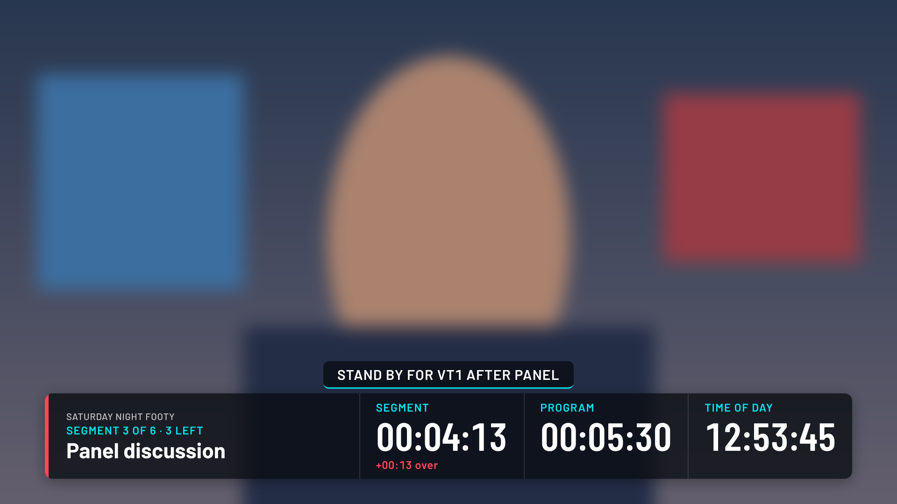

# DA Timer

Segment and program timer for broadcast Director's Assistants. It runs with a dual-screen output on Windows and Mac.

* **Timing:** segment and program clocks with goals and over/under, back-timing to a hard out, and NTP or LTC time sync.
* **Log:** notes and marks with time-of-day and program time, exported to Excel.
* **Output screen:** stacked, side by side, or drag the clocks anywhere; a No show mode shows just the time of day between shows (talent messages still show on top, so you can cue during rehearsals).
* **Talent messages:** send cues like WRAP UP or 30 SECONDS across the top of the output monitor and, optionally, the video overlay.
* **Stream Deck:** works directly over USB, or through the Elgato plugin (in `StreamDeck/`).
* **Settings and safety:** a settings screen to switch features off, undo, and crash recovery.

See **DA Timer Help.pdf** for how to use it.

## Video overlay

DA Timer serves a transparent lower-third at `http://127.0.0.1:47800/overlay` for OBS, vMix or any HTML input (1920 × 1080). In the app: **Output to monitor ▾ → Video overlay** for the address, and **Design video overlay** to choose what shows, sizes, colours, logo, position and fonts.

## Security

The control server only listens on this computer (`127.0.0.1:47800`) unless you turn on **Settings → Video overlay on other computers**.

* Every request must be addressed to this computer (`127.0.0.1`, `localhost`, its own name or a numeric address), which blocks web pages that try "DNS rebinding" to reach it. A browser `Origin` from anywhere else is refused, and there are no cross-site reads.
* Commands need **POST**, the `X-DA-Timer` header, and must come from this computer.
* In LAN mode other computers can only view, and need the `?key=` part of the address DA Timer shows (a random key per install).
* Requests are size-limited, idle connections time out, and a flood of commands can't stall the clocks.

Found a security problem? Please report it privately through GitHub's **Security → Report a vulnerability**, not as a public issue.

## Tests

`python -m pytest -q` runs the headless logic tests (no window, audio, Stream Deck or network). `tests/smooth_ticks.py` checks the clocks tick evenly (needs a display; exits 1 on a stall).

## Run it

* **Windows:** double-click `Run DA Timer.bat`. It needs 64-bit Python 3.12.
* **Mac:** double-click `Run DA Timer.command`. It needs Python 3.12 from python.org.

Both install exact, hash-checked package versions from `requirements.txt` the first time.

## Release a new version

Actions → **Publish release (new version)** → Run workflow, then type the version number (it must match `VERSION` in `da_timer.py`). GitHub creates the release, builds the Windows and Mac apps and attaches them.

## Build it

* **Windows .exe:** go to Actions → **Test build: Windows** → Run workflow, then download it from Artifacts. Or run `Build EXE.bat` on a Windows PC.
* **Mac .app:** go to Actions → **Test build: Mac** → Run workflow, then download the zips from Artifacts. See `MAC - READ ME.txt`.

Builds use pinned, hash-checked packages (`requirements-build.txt`) and GitHub Actions pinned to exact commits, and run with read-only access; only the final upload step can write to a release. Each release download has a `.sha256` file and a signed build attestation (`gh attestation verify <zip> --repo domwato/DATIMER`).

## Licence

MIT - see `LICENSE`. Third-party parts keep their own licences (`THIRD-PARTY-LICENSES.txt`).

Not affiliated with or endorsed by any broadcaster or by Elgato.
