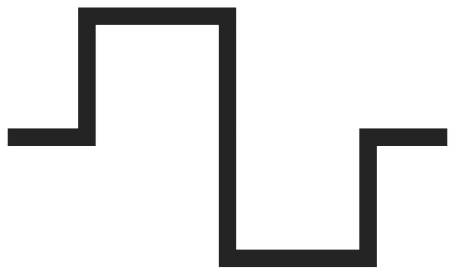

# DA Timer

Segment and program timer for broadcast Director's Assistants. It runs with a dual-screen output on Windows and Mac.

* **Timing:** segment and program clocks with goals and over/under, back-timing to a hard out, and NTP or LTC time sync.
* **Log:** notes and marks with time-of-day and program time, exported to Excel.
* **Stream Deck:** works directly over USB, or through the Elgato plugin (in `StreamDeck/`).
* **Settings and safety:** a settings screen to switch features off, undo, and crash recovery.

See **DA Timer Help.pdf** for how to use it.

## Run it

* **Windows:** double-click `Run DA Timer.bat`. It needs 64-bit Python 3.12.
* **Mac:** double-click `Run DA Timer.command`. It needs Python 3.12 from python.org.

## Release a new version

Actions → **Publish release** → Run workflow, then type the version number (it must match `VERSION` in `da_timer.py`). GitHub creates the release, builds the Windows and Mac apps and attaches them.

## Build it

* **Windows .exe:** go to Actions → **Build Windows app** → Run workflow, then download it from Artifacts. Or run `Build EXE.bat` on a Windows PC.
* **Mac .app:** go to Actions → **Build Mac app** → Run workflow, then download the zips from Artifacts. See `MAC - READ ME.txt`.

## Licence

MIT - see `LICENSE`. Third-party parts keep their own licences (`THIRD-PARTY-LICENSES.txt`).

Not affiliated with or endorsed by any broadcaster or by Elgato.
